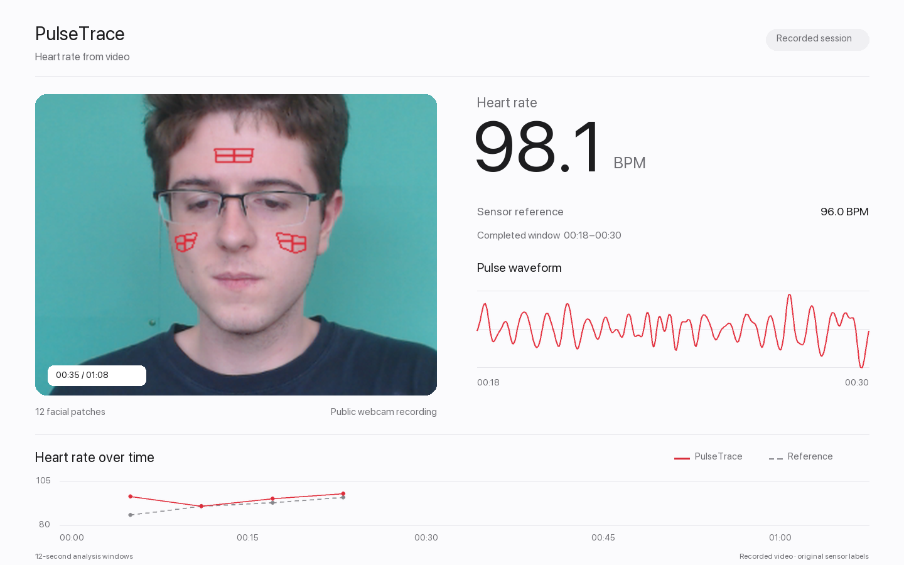

# PulseTrace

Heart-rate estimation from video. PulseTrace tracks facial skin, extracts subtle
color changes, and turns them into quality-gated pulse estimates, waveforms, and
trends. Built with Python, OpenCV, MediaPipe, NumPy, and SciPy.

## Demo

[](https://github.com/varunmenon0/PulseTrace/blob/main/assets/PulseTrace-Demo.mp4)

[Watch the full 68-second demo](https://github.com/varunmenon0/PulseTrace/blob/main/assets/PulseTrace-Demo.mp4)
· [Download the video](https://raw.githubusercontent.com/varunmenon0/PulseTrace/main/assets/PulseTrace-Demo.mp4)

A complete public webcam recording, analyzed with twelve facial patches and POS
signal extraction. The demo shows the extracted waveform, completed-window heart
rate, matching sensor reference, and pulse trend. All **10/10 windows** in this
selected development recording are scorable. Estimates appear only after their
analysis window ends; unavailable estimates remain gaps.

The interface uses native sans-serif typography, generous spacing, neutral
surfaces, and a restrained red pulse accent. See the [design notes](docs/DEMO_DESIGN.md)
and [source attribution](assets/README.md).

## Features

- **Face tracking:** 478 landmarks anchor forehead and cheek sampling regions.
- **Twelve-patch sampling:** geometry-balanced patches with optional fractional
  pixel coverage and patch or region voting.
- **Pulse extraction:** POS and green-channel methods with spectral diagnostics.
- **Quality-aware trends:** motion and tracking-loss exclusions, clean continuous
  support, and explicit gaps when a window cannot support an estimate.
- **Useful exports:** CSV signals, JSON diagnostics, plots, and annotated video.
- **Reproducible evaluation:** fixed protocols, source hashes, paired comparisons,
  reference checks, synthetic fixtures, and automated CI.

## Measured results

| Evaluation | Result |
|---|---|
| Selected demo recording | 10/10 scorable windows |
| Frozen five-recording real-video check | 28/36 reference-valid windows scorable; 3.96 BPM mean absolute difference from device labels |
| Largest accepted difference in that check | 15.16 BPM |
| Six clean synthetic clips, 48–180 BPM | 0.003 BPM mean error; less than 0.013 BPM maximum error |
| Changing-rate synthetic tracking | 21/21 windows recovered; 0.041 BPM POS mean error |

The five-recording evaluation decoded 9,463 frames and produced estimates in
34/49 nominal windows; 28 estimates were reference-valid and scorable. These
small-cohort comparisons use the original device labels and assumed zero clock
offset. The selected demo is separate from that frozen cohort. Synthetic results
measure recovery of injected signals and are reported separately from natural
video results.

See the [real-video demonstration and frozen evaluation](docs/PUBLIC_DEMONSTRATION.md),
[real-video sampling study](docs/REAL_VIDEO_RECOVERY.md),
[controlled-video benchmark](docs/CONTROLLED_VIDEO.md), and
[changing-pulse benchmark](docs/PULSE_TRENDS.md) for protocols and complete denominators.

PulseTrace is a complete **recorded-video analysis project**. Live camera capture
is a future application: the current processing uses offline filtering and
buffered motion exclusions. The [live-camera design notes](docs/LIVE_CAMERA.md)
document the timing and validation work needed for streaming. These evaluations
do not establish medical-device accuracy.

## Quick start

Use Python **3.10–3.12**, preferably 3.12:

```bash
python3.12 -m venv .venv
source .venv/bin/activate
python -m pip install -e '.[dev]'
pytest -q
pulsetrace demo --profile clean --patches --consensus zone --output outputs/demo
```

Windows: use `py -3.12 -m venv .venv` and `.venv\Scripts\activate`.
The model-free demo renders a clean face-shaped video with a known 72 BPM skin
pulse and runs it through lossless decoding, twelve-patch sampling, signal
processing, and report generation. Use `--profile standard` for the original
noisy fixture, or compare `mild_noise`, `slow_light`, and `periodic_light` profiles.

Minimal Ubuntu/Debian environments may need:

```bash
sudo apt-get update
sudo apt-get install libgles2 libegl1 libgl1 libglib2.0-0
```

Use the project's `opencv-contrib-python` dependency as the single OpenCV wheel
provider. Charts render headlessly with Matplotlib's Agg backend.

## Analyze a video

Download the versioned Face Landmarker asset with SHA256 verification:

```bash
python scripts/download_model.py
pulsetrace analyze recording.mp4 \
  --model models/face_landmarker.task \
  --patches --regional-quality \
  --output outputs/recording --method pos
```

Use `--consensus zone` with `--patches` to give each supported facial region one
vote. Both patch and regional reports record the chosen policy.

Use `--method green` to compare green-channel extraction, `--max-seconds 30` to
select a duration, and `--overlay` to export annotated tracking video. The default
sampling mode uses the three parent regions; `--patches` adds the twelve-patch
comparison. Fractional sampling and photometric policies have dedicated offline
experiment commands in the linked reports.

For repeatable captures, record one consenting person for 20–30 seconds at about
30 FPS, with a large, unobstructed face and stable diffuse lighting. The default
minimum continuous segment is 10 seconds, maximum interpolated internal detection
gap is 0.25 seconds, and minimum inset region size is 30 pixels.

Exit code 0 indicates an available estimate; code 2 identifies invalid input or
insufficient usable data. Reports include timestamps, selected segments, sample
availability, and estimate diagnostics. `pulsetrace --help` lists all commands.

## Pipeline

1. **Decode:** stream frames and timestamps through OpenCV, recording timing fallbacks.
2. **Track:** run MediaPipe VIDEO inference and accept single-face frames.
3. **Sample:** average RGB over landmark-anchored, eroded forehead and cheek masks;
   optionally subdivide them into twelve patches.
4. **Prepare:** select continuous segments, resample to a uniform time grid, and
   interpolate short internal detection gaps.
5. **Extract:** use normalized green intensity or rolling 1.6-second POS projection.
6. **Filter:** detrend and apply an offline fourth-order, zero-phase Butterworth
   bandpass covering 40–200 BPM.
7. **Estimate:** calculate Welch power spectra, refine the spectral peak, and apply
   flat-signal, band-edge, and concentration checks.
8. **Compare:** combine regional candidates with consensus and export waveforms,
   spectra, overlays, quality diagnostics, and evaluation metrics.

## Outputs

| File | Contents |
|---|---|
| `rgb.csv` | Timestamps, RGB means, pixel counts, and geometry diagnostics |
| `*_pulse.csv` | Filtered regional waveforms |
| `*_spectrum.csv` | Welch power spectral density |
| `waveforms.png` | Regional waveform and spectrum plots |
| `regions.png` | Sampled facial-region overlay |
| `summary.json` | Estimates, timing, sample availability, and diagnostics |
| `patch_comparison.json` | Three-region versus twelve-patch comparison |
| `pulse_trend.csv`, `pulse_trend.json`, `pulse_trend.png` | Windowed estimates, timing, coverage, and curves with `--track` |
| `regional_comparison.json` | Global versus regional exclusion comparison |

## Documentation

See the [documentation index](docs/README.md) for evaluation results, reproduction
instructions, diagnostics, interface design, and the path to live-camera use.
Earlier experiments remain available in the [research archive](docs/archive/README.md).

## Development

This branch (`work/live-window-engine`) also includes an experimental local
webcam command and streaming replay with a same-sample batch check. See the
[streaming prototype guide](docs/STREAMING.md) for setup, timing, and limitations.
The prototype is kept separate from `main`; live-camera accuracy is not yet measured.

```bash
pytest -q
pulsetrace demo --bpm 96 --seconds 20 --method green --output outputs/green-demo
python -m build
```

Tests cover signal processing, ROI geometry, twelve-patch consensus, timestamps,
tracking loss, motion exclusions, photometric stress cases, reference provenance,
CLI reports, and package integration. The optional MediaPipe test uses explicit
asset paths:

```bash
PULSETRACE_TEST_MODEL=models/face_landmarker.task \
PULSETRACE_TEST_PORTRAIT=/absolute/path/to/portrait.jpg pytest -q
```

See [VALIDATION.md](docs/archive/VALIDATION.md) for environment and model-integration records.
`requirements-tested.txt` records the tested environment; `pyproject.toml`
defines supported dependency ranges.

## References

- [MediaPipe Face Landmarker](https://ai.google.dev/edge/mediapipe/solutions/vision/face_landmarker/python)
- Wang et al. (2017), *Algorithmic principles of remote PPG*,
  [IEEE TBME](https://doi.org/10.1109/TBME.2016.2609282)
- [SciPy zero-phase filtering](https://docs.scipy.org/doc/scipy/reference/generated/scipy.signal.sosfiltfilt.html)
- [SciPy Welch PSD](https://docs.scipy.org/doc/scipy/reference/generated/scipy.signal.welch.html)

MIT licensed. Downloaded models and dataset assets retain their upstream terms.
