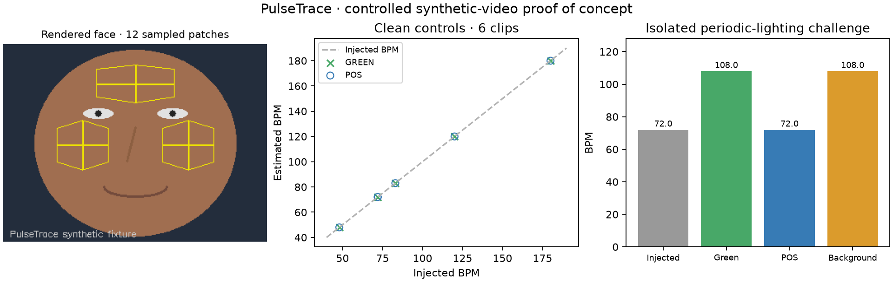

# PulseTrace

Video-based heart-rate estimation using computer vision and remote
photoplethysmography (rPPG). PulseTrace tracks facial regions, extracts RGB
signals, and estimates pulse frequency with POS and green-channel processing.

**Python · OpenCV · MediaPipe · NumPy · SciPy · Matplotlib · GitHub Actions**

## Highlights

- **12 facial patches** across the forehead and cheeks, with selectable patch or zone voting.
- **478-landmark face tracking**, timestamp-aware video decoding, and ROI overlays.
- **Windowed pulse trends** with quality-gated estimates, CSV exports, and plots over time.
- **Motion-aware analysis** with buffered exclusions and separate continuous segments.
- **Fractional pixel coverage and geometry-balanced patches** for sampling experiments.
- **Lossless synthetic demos** with skin-localized pulse signals and an independent background reference.
- **Reproducible evaluation** with source hashes, paired comparisons, coverage metrics,
  and external beat-time reference support.
- **182 passing automated tests**, plus an optional model-backed integration check.
- **Continuous integration** running tests, a synthetic video demo, and package builds.

## Real-video analysis

The [public-video demonstration](PUBLIC_DEMONSTRATION.md) renders facial patches,
an extracted pulse waveform, completed-window BPM, and reference comparison over
a complete real recording with **10/10 scorable windows**. A separate frozen
five-recording check processed **9,463 new frames**, with twelve-patch POS scoring
**28/36 reference-valid windows** at **3.96 BPM mean device-label difference**.
The report retains all-window counts, failures, and maximum differences.

```bash
pulsetrace analyze recording.mov --model models/face_landmarker.task \
  --sampling fractional --patches --method pos --track \
  --window-policy continuous --output outputs/real-recording
```

The optional fractional sampler was tested on two new real UBFC recordings
using identical tracked landmarks. Scorable 12-patch POS coverage increased
from **11/17 to 13/17 windows**, while average absolute device-label difference
changed from **2.67 to 1.97 BPM**. Across the nine common windows it changed from
2.47 to 2.25 BPM. Four new recordings were processed with native face tracking,
covering **8,150 frames**.

See [real-video results and reproduction](REAL_VIDEO_RECOVERY.md), including
aggregate outcomes, gained/lost counts, reference checks, and comparison
with the original sampling and full-window policies.

## Synthetic proof of concept

The controlled video suite recovers injected pulse rates across six clean clips
with **0.003 BPM mean error** and **less than 0.013 BPM maximum error**. It tests
48–180 BPM signals and 30/60 FPS inputs using known rendered geometry.



See the [controlled-video benchmark](CONTROLLED_VIDEO.md) for the exact fixtures,
separate lighting challenge, and reproduction command.

### Track a changing synthetic pulse

```bash
pulsetrace demo --profile clean --bpm 72 --end-bpm 108 --seconds 60 \
  --patches --consensus zone --track --output outputs/rising-pulse
```

The [controlled tracking benchmark](PULSE_TRENDS.md) recovered **21/21 windows**
across rising, falling, and constant-rate cases, with **0.041 BPM POS mean error**
against the injected window-average rates.

### Recover after abrupt motion

The [controlled motion benchmark](MOTION_RECOVERY.md) retains **7/7 readings**
during gentle translation, excludes both windows affected by a sharp motion
burst, and recovers all five clean windows. Trend exports include the excluded
regions and shared motion/loss flags.

```bash
pulsetrace demo --profile motion_burst --bpm 72 --seconds 48 \
  --patches --consensus zone --track --output outputs/motion-demo
```

The [face-loss benchmark](TRACKING_LOSS.md) also tests a brief disappearance
during a rising pulse and a face that never returns. Trend exports retain gaps,
identify missing-sample regions, and explain unavailable estimates.

## Measured engineering results

| Experiment | Result |
|---|---|
| Balanced patch support | All 12 patches available across 4,017 frames from two UBFC development recordings |
| Fractional mask geometry | Area-step events fell from 72 to 8 on subject 14 |
| Area-source gate comparison | Scorable windows increased from 6/20 to 17/20 with unchanged thresholds |
| Artifact stress suite | Seven deterministic RGB/geometry cases covering motion, sample loss, attenuation, and lighting |

These metrics describe sampling, coverage, and controlled stress tests. Heart-rate
comparisons, reference definitions, and per-window results are documented in the
[evaluation reports](#evaluation-and-experiments).

## Quick start

Use Python **3.10–3.12**, preferably 3.12:

```bash
python3.12 -m venv .venv
source .venv/bin/activate
python -m pip install -e '.[dev]'
pytest -q
pulsetrace demo --profile clean --patches --consensus zone --output outputs/demo
```

Windows: use `py -3.12 -m venv .venv` and `.venv\Scripts\activate`.
The model-free demo renders a clean face-shaped video with a known 72 BPM skin
pulse and runs it through lossless decoding, twelve-patch sampling, signal
processing, and report generation. Use `--profile standard` for the original
noisy fixture, or compare `mild_noise`, `slow_light`, and `periodic_light` profiles.

Minimal Ubuntu/Debian environments may need:

```bash
sudo apt-get update
sudo apt-get install libgles2 libegl1 libgl1 libglib2.0-0
```

Use the project's `opencv-contrib-python` dependency as the single OpenCV wheel
provider. Charts render headlessly with Matplotlib's Agg backend.

## Analyze a video

Download the versioned Face Landmarker asset with SHA256 verification:

```bash
python scripts/download_model.py
pulsetrace analyze recording.mp4 \
  --model models/face_landmarker.task \
  --patches --regional-quality \
  --output outputs/recording --method pos
```

Use `--consensus zone` with `--patches` to give each supported facial region one
vote. Both patch and regional reports record the chosen policy.

Use `--method green` to compare green-channel extraction, `--max-seconds 30` to
select a duration, and `--overlay` to export annotated tracking video. The default
sampling mode uses the three parent regions; `--patches` adds the twelve-patch
comparison. Fractional sampling and photometric policies have dedicated offline
experiment commands in the linked reports.

For repeatable captures, record one consenting person for 20–30 seconds at about
30 FPS, with a large, unobstructed face and stable diffuse lighting. The default
minimum continuous segment is 10 seconds, maximum interpolated internal detection
gap is 0.25 seconds, and minimum inset region size is 30 pixels.

Exit code 0 indicates an available estimate; code 2 identifies invalid input or
insufficient usable data. Reports include timestamps, selected segments, sample
availability, and estimate diagnostics. `pulsetrace --help` lists all commands.

## Pipeline

1. **Decode:** stream frames and timestamps through OpenCV, recording timing fallbacks.
2. **Track:** run MediaPipe VIDEO inference and accept single-face frames.
3. **Sample:** average RGB over landmark-anchored, eroded forehead and cheek masks;
   optionally subdivide them into twelve patches.
4. **Prepare:** select continuous segments, resample to a uniform time grid, and
   interpolate short internal detection gaps.
5. **Extract:** use normalized green intensity or rolling 1.6-second POS projection.
6. **Filter:** detrend and apply an offline fourth-order, zero-phase Butterworth
   bandpass covering 40–200 BPM.
7. **Estimate:** calculate Welch power spectra, refine the spectral peak, and apply
   flat-signal, band-edge, and concentration checks.
8. **Compare:** combine regional candidates with consensus and export waveforms,
   spectra, overlays, quality diagnostics, and evaluation metrics.

## Outputs

| File | Contents |
|---|---|
| `rgb.csv` | Timestamps, RGB means, pixel counts, and geometry diagnostics |
| `*_pulse.csv` | Filtered regional waveforms |
| `*_spectrum.csv` | Welch power spectral density |
| `waveforms.png` | Regional waveform and spectrum plots |
| `regions.png` | Sampled facial-region overlay |
| `summary.json` | Estimates, timing, sample availability, and diagnostics |
| `patch_comparison.json` | Three-region versus twelve-patch comparison |
| `pulse_trend.csv`, `pulse_trend.json`, `pulse_trend.png` | Windowed estimates, timing, coverage, and curves with `--track` |
| `regional_comparison.json` | Global versus regional exclusion comparison |

## Evaluation and experiments

| Report | Focus |
|---|---|
| [Windowed pulse tracking](PULSE_TRENDS.md) | Changing-rate synthetic videos and quality-gated trends |
| [Controlled synthetic videos](CONTROLLED_VIDEO.md) | Lossless fixtures, injected pulse references, and lighting cues |
| [Public video evaluation](PUBLIC_VALIDATION_MULTI.md) | UBFC development recordings and reference checks |
| [Fixed-rule evaluation](FROZEN_EVALUATION.md) | Preserved protocol and results on subjects 12–14 |
| [Region-balanced voting](ZONE_CONSENSUS.md) | Two-level consensus and six-recording candidate replay |
| [Sampling comparison](SAMPLING_EVALUATION.md) | Paired integer and balanced fractional sampling |
| [Patch support](PATCH_SUPPORT.md) | Geometry scale and sampling-lattice study |
| [Area-source gates](AREA_GATE_EVALUATION.md) | Identical-RGB comparison of gate area measurements |
| [Artifact stress tests](PHOTOMETRIC_GUARD.md) | Optional broad RGB-step guard and controlled lighting cases |
| [External beat references](REFERENCE_PROTOCOL.md) | Provenance, clock offsets, and beat-time scoring |
| [Diagnostics](DIAGNOSTICS.md) | RGB, shape, movement, and window-level inspection |

Each report identifies its input data, settings, scoring protocol, and results.
Synthetic fixtures and natural-video evaluations are reported separately.
Numeric examples live in `examples/`; recordings and model assets are acquired
through the documented download scripts.

## Development

```bash
pytest -q
pulsetrace demo --bpm 96 --seconds 20 --method green --output outputs/green-demo
python -m build
```

Tests cover signal processing, ROI geometry, twelve-patch consensus, timestamps,
tracking loss, motion exclusions, photometric stress cases, reference provenance,
CLI reports, and package integration. The optional MediaPipe test uses explicit
asset paths:

```bash
PULSETRACE_TEST_MODEL=models/face_landmarker.task \
PULSETRACE_TEST_PORTRAIT=/absolute/path/to/portrait.jpg pytest -q
```

See [VALIDATION.md](VALIDATION.md) for environment and model-integration records.
`requirements-tested.txt` records the tested environment; `pyproject.toml`
defines supported dependency ranges.

## References

- [MediaPipe Face Landmarker](https://ai.google.dev/edge/mediapipe/solutions/vision/face_landmarker/python)
- Wang et al. (2017), *Algorithmic principles of remote PPG*,
  [IEEE TBME](https://doi.org/10.1109/TBME.2016.2609282)
- [SciPy zero-phase filtering](https://docs.scipy.org/doc/scipy/reference/generated/scipy.signal.sosfiltfilt.html)
- [SciPy Welch PSD](https://docs.scipy.org/doc/scipy/reference/generated/scipy.signal.welch.html)

MIT licensed. Downloaded models and dataset assets retain their upstream terms.
