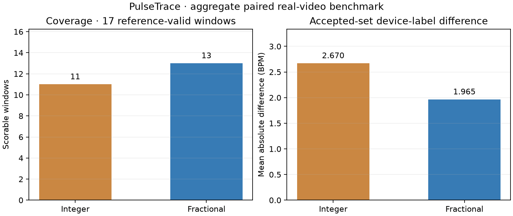

# Real-video pulse recovery

PulseTrace now supports fractional-pixel sampling directly in the real-video CLI,
plus an optional continuous-window policy that analyzes clean footage around
brief disturbances. This work reproduced six existing recordings and processed
four new UBFC recordings with the native MediaPipe tracker: **8,150 new frames**.

## Run on a recording

```bash
pulsetrace analyze recording.mov --model models/face_landmarker.task \
  --sampling fractional --patches --method pos --track \
  --window-policy continuous --output outputs/real-recording
```

This produces RGB samples, ROI previews, pulse trends, CSV/JSON diagnostics,
the original full-window report, and a separate continuous comparison.
The native CLI was also exercised on the first 36 seconds of real subject 16:
fractional sampling with continuous windows produced POS estimates in all five
nominal windows. That is a CLI integration check, separate from the fresh-cohort
accuracy comparison below.

`--sampling landmarks` and `--window-policy full` remain the defaults. The new
choices are explicit experiments; the synthetic fixtures remain regression tests.

## What was failing

All six archived real-video baselines reproduced their historical regional-gate
decisions. For 12-patch POS, 17/53 reference-valid windows were scorable, with
1.286 BPM average absolute difference from stored device labels. Of 57 total
windows, 31 failed the regional quality gate and nine failed patch consensus.

The initial fresh check used subjects 15 and 16, fixed before viewing their
signals. Neither recording had missing-face samples or displacement spikes.
Integer patch-area changes generated 64 and 24 globally flagged frames,
respectively. The tracked ROIs were small enough for integer pixel boundaries
to be a plausible contributor. Subsequent paired sampling isolated the effect
of the sampler and its area measurements while holding landmarks fixed.

## Clean continuous support

The optional policy selects the longest uninterrupted section within each
12-second nominal window that has at least two usable parent regions for its
entire duration. It requires at least 10 seconds, preserves the existing
motion/area thresholds and 0.5-second buffer, and never joins separated sections.
Selection uses geometry and validity masks only, before estimating BPM.

| 12-patch POS cohort | Full-window scorable coverage | Continuous scorable coverage | Full / continuous accepted-set device-label MAE |
|---|---:|---:|---:|
| Six previous development recordings | 17/53 | 21/53 | 1.286 / 1.719 BPM |
| New subjects 15 and 16 | 3/20 | 5/20 | 1.852 / 2.093 BPM |

The policy preserved all original accepted readings in these cohorts. Newly
admitted development windows had 3.563 BPM MAE, including one 9.640 BPM
difference; the two newly admitted fresh windows had 2.456 BPM MAE. Subject 15
remained unavailable under both policies. These outcomes support keeping the
continuous policy optional rather than describing coverage alone as accuracy.

Continuous reports include `analysis_start_s`, `analysis_end_s`, and
`analysis_duration_s`. Trends plot the actual analyzed-support center but become
available at the nominal window end. Reference labels are evaluated over the
actual support; nominal reference-invalid windows remain outside the common
scoring denominator. Motion/loss flags and sample-loss regions describe the
nominal window, which can contain unused excluded frames.

## Fractional sampling on two more new recordings

The next protocol reserved subjects 17 and 18 before acquisition and before
integrating the sampler. Each recording was tracked once. A second decoding
pass replayed the exact same landmarks and verified every timestamp.

The fractional sampler uses the existing eight-by-eight subpixel coverage
lattice, one-pixel inset, and equal-area geometric subdivision into four patches
per parent. Area thresholds use effective covered pixels, not rasterized preview
areas. Integer and fractional samplers retain identical quality thresholds,
filters, POS processing, and patch consensus. Both RGB and area measurements
change, so this measures the combined sampling/gating change.



| Subjects 17 and 18, full-window 12-patch POS | Integer | Fractional |
|---|---:|---:|
| Scorable windows / reference-valid windows | 11/17 | 13/17 |
| Estimates / all nominal windows | 13/20 | 16/20 |
| Accepted-set mean absolute device-label difference | 2.670 BPM | 1.965 BPM |
| Maximum accepted device-label difference | 6.386 BPM | 5.807 BPM |
| Raw area-flag frames, either parent | 43 | 0 |
| Windows rejected for fewer than two usable parents | 5 | 0 |

Nine scorable windows were common to both samplers. Their mean absolute
device-label difference changed from **2.471 to 2.253 BPM**. Fractional sampling
gained four scorable windows and lost two, for a net gain of two. All four gains
had differences below 1.72 BPM; gained and lost counts are reported separately.
Continuous support added no further estimates on these two recordings.

Three nominal windows had invalid device labels and remain unscorable even
when video estimates exist. The public plot shows aggregate results.

The three-parent baseline remains in every report. Fractional three-parent POS
scored 15/17 windows at 2.018 BPM MAE, compared with 11/17 at 2.480 BPM for integer
sampling. In this cohort, twelve patches had slightly lower accepted-set error
but fewer readings than the parent regions; patch count alone is not a guarantee
of a better estimate.

## Reference checks and scope

The [official UBFC description](https://sites.google.com/view/ybenezeth/ubfcrppg)
documents webcam video and pulse-oximeter waveform/heart-rate acquisition.
This experiment uses the existing public mirror with recorded video/reference
hashes, native MediaPipe 0.10.21, and the existing assumed zero elapsed-time offset.
Independent hardware clock mapping and reviewed beat annotations are still not
available for these mirrored files.

The contact-only waveform audit was run separately. Across all ten recordings,
it flagged seven greater-than-10 BPM device/spectral disagreements in 97 windows.
This exploratory audit did not replace labels, select video estimates, or alter
time offsets. The reported error remains device-label difference, with overlapping
windows and small same-dataset cohorts. Subjects 15–18 are now seen data for any
subsequent algorithm changes.

The evidence supports a useful optional fractional sampler on real recordings.
The next acquisition test is a MacBook recording with an independently recorded
pulse reference. Stable indoor lighting and visible cheek skin will provide a
useful first check; exposure changes and movement can then be introduced separately.

## Reproduce and inspect

Download each new recording using its committed source manifest:

```bash
python scripts/download_ubfc_sample.py \
  --manifest examples/real-video-recovery/subject17/source.json \
  --output outputs/real-video-recovery/subject17
```

Repeat for subject 18, then extract paired samplers for each recording:

```bash
python scripts/benchmark_real_sampling.py \
  --source outputs/real-video-recovery/subject17 \
  --model models/face_landmarker.task --output outputs/real-video-sampling
```

Score each sampler against the same fixed protocol:

```bash
python scripts/evaluate_real_recovery.py \
  --root outputs/real-video-sampling/integer --cohort fresh \
  --protocol examples/real-video-recovery/sampling-protocol.json \
  --output outputs/real-video-sampling/integer-evaluation
```

Repeat with `fractional` in both sampler paths, then summarize:

```bash
python scripts/report_real_sampling.py --root outputs/real-video-sampling \
  --output outputs/real-video-sampling/report
```

The [evaluation directory](examples/real-video-recovery) contains both protocols,
all four source manifests, aggregate cohort metrics, the paired common/gained/lost
comparison, area-event counts, and aggregate contact-audit counts. Detailed
per-window measurement reports remain local and can be regenerated by the commands
above. Raw videos, models, and RGB caches stay outside version control.
