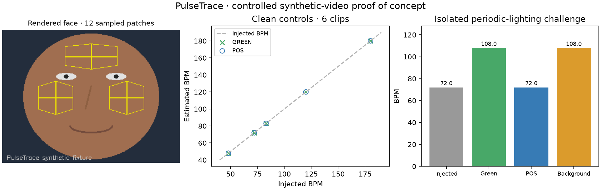

# Controlled synthetic-video proof of concept

PulseTrace can generate clean, face-shaped video fixtures with a known pulse
component applied only to the skin. The background, eyes, and other features
remain separate. Lossless FFV1 encoding preserves the generated 8-bit frames.
Known region geometry makes the demo reproducible without a model download.

```sh
pulsetrace demo --profile clean --bpm 83 --fps 30 --seconds 20 \
  --patches --consensus zone --output outputs/clean-demo
```

The command creates and decodes the video, extracts all twelve patches, runs
POS and green processing, and exports waveform/spectrum plots and comparison
reports. `summary.json` records the fixture settings and injected BPM;
`controlled_check.json` contains independently computed estimates and a
method-agreement diagnostic. Expected BPM is used for scoring, not candidate
selection or warning decisions.

## Fixture profiles

| Profile | Conditions |
|---|---|
| `clean` | Stable geometry and lighting, zero added pixel noise |
| `mild_noise` | Independent skin noise with standard deviation 0.25 intensity units |
| `slow_light` | Four-percent global illumination drift at 0.15 Hz |
| `periodic_light` | Five-percent global modulation at 1.8 Hz, separate from the skin pulse |

Skin pulse amplitudes are fixed at RGB (0.6, 3.0, 0.2) intensity units. Every case
uses the same analysis filters, spectral checks, and consensus rules. A fixed
corner samples background brightness; that reference contains no injected skin
pulse. The agreement diagnostic compares green, POS, and background estimates
with a fixed 5 BPM tolerance. It reports method disagreement and a shared-lighting
cue without replacing either estimator's output.

## Benchmark plan

`examples/controlled-video/protocol.json` fixes nine 20-second cases: five clean
rates (48, 72, 83, 120, 180 BPM) at 30 FPS; 72 BPM at 60 FPS; and three isolated
variation/challenge profiles at 72 BPM. The off-grid 83 BPM case exercises spectral
interpolation. Clean controls, controlled variations, and lighting challenges
are scored separately. Missing estimates remain in coverage denominators.

These are encoded synthetic video tests with known geometry, not natural-video
or MediaPipe face-detection measurements. The original `standard` demo remains
available. Artifact profiles are independent test cases rather than conditions
selected to match an expected heart rate.

## Measured proof-of-concept results

The fixed nine-case suite generated and decoded 6,000 frames. All parent regions
and all twelve patches retained 100% valid frame coverage. Rates below are scored
after decoding against the known injected skin-pulse frequency.

| Group | Clips | Decoded frames | Green mean absolute error | POS mean absolute error |
|---|---:|---:|---:|---:|
| Clean controls | 6 | 4,200 | 0.002706 BPM | 0.002841 BPM |
| Mild noise / slow lighting | 2 | 1,200 | 0.001630 BPM | 0.003002 BPM |
| Isolated periodic lighting | 1 | 600 | 36.009370 BPM | 0.000203 BPM |

Both methods returned estimates in every case. Across the six clean clips, the
maximum error was 0.012441 BPM. Those clips cover five distinct rates from 48 to
180 BPM, including an off-grid 83 BPM signal, and 30/60 FPS video inputs. These
frame rates describe the test inputs; no processing-throughput claim is made.

In the periodic-lighting case, green estimated 108.009 BPM, the independently
sampled background estimated approximately 108 BPM, and POS estimated 72.000 BPM.
The shared-lighting cue was active on that case and inactive on all eight clean
or mild-variation cases. The diagnostic records both estimates; it does not
substitute an injected/expected rate into the result.



## Reproduce the suite

```sh
python scripts/benchmark_controlled.py --output outputs/controlled-video/benchmark
```

Outputs include lossless AVI fixtures, per-frame truth CSV files, a complete JSON
report, and PNG/SVG summary plots. The committed results are in
`examples/controlled-video/benchmark.json`; input videos are regenerated from the
protocol rather than committed. Each report records video hashes, seeds, profile
settings, codec, frame counts, sample coverage, estimates, cue results, and
separate per-group error/coverage summaries. Missing estimates remain counted.

Tests verify lossless round trips, pulse localization, unchanged clean background,
CLI execution, all twelve patch reports, and cue logic. A regression test changes
`expected_bpm` metadata to an incorrect value and confirms that signal estimates
still follow the decoded video's actual injected component. The full pipeline
runs without a face-model download for these controlled fixtures.
