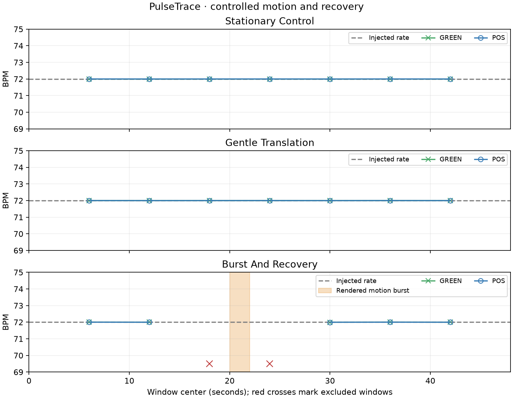

# Controlled motion and pulse recovery

PulseTrace now includes reproducible moving-face video fixtures and exports the
quality decisions behind gaps in its pulse trends. This experiment exercises the
existing motion gate through video encoding, decoding, 12-patch sampling, and
windowed signal estimation.



## Results

All three lossless synthetic clips contain a 72 BPM skin-localized pulse, run for
48 seconds at 30 FPS, and use the same zone consensus and default quality settings.
Each produces seven 12-second windows, stepped every six seconds.

| Synthetic case | POS readings / windows | Shared-motion exclusions | POS mean absolute error on accepted windows |
|---|---:|---:|---:|
| Stationary control | 7 / 7 | 0 | 0.0014 BPM |
| Gentle translation | 7 / 7 | 0 | 0.0014 BPM |
| Sharp burst and recovery | 5 / 7 | 2 | 0.0018 BPM |

The suite decodes **4,320 frames**. Both green and POS leave both motion-affected
windows empty. All 19 accepted POS windows are within 0.003 BPM of the injected
rate. Missing windows remain in the coverage denominator and are never filled.

The burst occupies seconds 20–22. Windows beginning at 12 and 18 seconds overlap
the buffered motion events and lose all three parent regions. The first recovered
window covers seconds 24–36: its plot point is at 30 seconds, and its estimate is
available at 36 seconds. The resulting availability delay after the event is
**14 seconds**, reflecting the fixed window duration and step.

## Fixture and scoring

- Gentle motion translates the rendered image by integer-rounded sinusoids with
  horizontal amplitude 6 pixels at 0.5 Hz and vertical amplitude 3 pixels at 0.25 Hz.
- The burst switches between horizontal offsets of +14 and -14 pixels every
  0.1 seconds during seconds 20–22, then returns to its original position.
- Translation uses nearest-neighbor sampling and preserves the injected colors.
  Known fixture landmarks follow the same translation exactly. This is a test of
  sampling and quality decisions under perfect tracking.
- The existing displacement threshold of 0.05 eye distances and 0.5-second
  exclusion buffer stay unchanged. An excluded frame makes its parent region
  unavailable for that whole window.
- Pulse truth and the event interval are used for scoring only after estimation.
  The motion policy conservatively rejects rapid displacement even with perfect
  landmark tracking and an otherwise clean pulse signal.

The committed [protocol](../examples/motion-recovery/protocol.json) defines the cases.
The [machine-readable result](../examples/motion-recovery/benchmark.json) records video
hashes, decoded counts, per-window estimates, exclusions, errors, and recovery
availability times. The benchmark uses synthetic geometry, separately from
MediaPipe tracking of natural video.

## Reproduce

```bash
python scripts/benchmark_motion_recovery.py --output outputs/motion-recovery
```

Run the burst case through the regular CLI:

```bash
pulsetrace demo --profile motion_burst --bpm 72 --seconds 48 \
  --patches --consensus zone --track --output outputs/motion-demo
```

Use `--profile steady_motion` for gentle motion. Burst clips require at least
36 seconds so they include both the event and a complete recovered window.
Trend JSON and CSV now include `shared_motion_or_loss` and `excluded_regions`.
The shared flag describes a geometry or tracking exclusion; an empty estimate
without that flag may instead reflect insufficient spectral or voting support.
