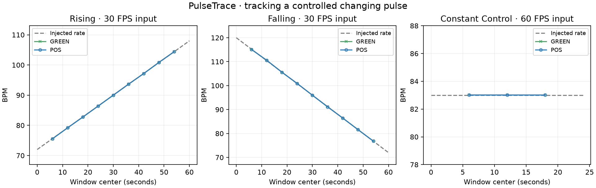

# Windowed pulse tracking

PulseTrace can export a pulse-rate curve from overlapping, quality-gated windows.
The new `--track` option uses twelve patches, the selected consensus policy,
12-second windows and six-second steps. Each row records both its center and the
time when its complete window is available. This is offline windowed analysis.

```sh
pulsetrace demo --profile clean --bpm 72 --end-bpm 108 --seconds 60 \
  --patches --consensus zone --track --output outputs/rising-pulse
```

`--end-bpm` adds a phase-continuous linear rate ramp to controlled synthetic
profiles. The instantaneous rate changes linearly; the rendered sine phase is
the integral of that rate. Omitting `--end-bpm` preserves the original constant
fixture behavior. The existing standard demo remains available.

For a supplied video:

```sh
pulsetrace analyze recording.mp4 --model models/face_landmarker.task \
  --patches --consensus zone --track --output outputs/pulse-trend
```

The command preserves normal regional and patch reports and adds:

| Output | Contents |
|---|---|
| `pulse_trend.csv` | Window bounds, center, availability time, green/POS estimates |
| `pulse_trend.json` | Quality-gated estimates, supporting patches/zones, coverage |
| `pulse_trend.png` | Both pulse-rate curves with missing estimates shown as gaps |

Tracking reuses the existing regional-window comparison rather than introducing
another filter or candidate selector. It respects `--max-gap`, regional quality
exclusions, and the chosen patch/zone consensus. Expected fixture rates are not
inputs to the tracking function. Rejected windows remain in the output and in
coverage denominators; there is no fill across missing estimates. Exit status
in tracking mode reflects availability of the selected method's window estimates.

## Fixed controlled benchmark

`examples/pulse-trends/protocol.json` defines rising 72–108 BPM and falling
120–72 BPM cases at 30 FPS over sixty seconds, plus a constant 83 BPM control at
60 FPS over twenty-four seconds. These use the clean, lossless synthetic renderer
and known geometry. All rate, sampling, filtering, and window settings are fixed
before scoring the suite.

The reference for a linear ramp is its analytic mean rate across each full
window, equivalent to the rate at the window center. This reference is computed
only after tracking. Output centers are not claims of instantaneous or causal
measurement; each estimate uses its complete twelve-second window.

## Measured controlled-video results

The three fixed videos generated and decoded 5,040 frames. Every parent region
and all twelve patches retained 100% valid sample coverage. Both methods returned
an estimate in all 21 quality-gated windows.

| Controlled case | Input | Windows | Green mean error | POS mean error |
|---|---|---:|---:|---:|
| Rising 72–108 BPM | 60 seconds, 30 FPS | 9/9 | 0.0306 BPM | 0.0334 BPM |
| Falling 120–72 BPM | 60 seconds, 30 FPS | 9/9 | 0.0543 BPM | 0.0594 BPM |
| Constant 83 BPM | 24 seconds, 60 FPS | 3/3 | 0.0125 BPM | 0.0099 BPM |
| Combined | 5,040 decoded frames | 21/21 | 0.0382 BPM | 0.0412 BPM |

Maximum window error was 0.167516 BPM for green and 0.152545 BPM for POS. Errors are
against analytic window-average rates of clean synthetic signals. Windows
overlap, and the renderer supplies known geometry. The input frame rates are
fixture settings, not measured processing throughput.



## Reproduce

```sh
python scripts/benchmark_pulse_trends.py --output outputs/pulse-trends
```

Each case exports its video, regional-window report, trend CSV/JSON, and trend
plot. The suite also writes a combined benchmark JSON and PNG/SVG summary. The
committed numeric results, protocol, and summary figures are in
`examples/pulse-trends/`. Videos are regenerated rather than committed. Reports
include video hashes, source settings, decoded frames, sample coverage, complete
window decisions, reference values, and per-case/combined errors.

Tests cover a phase-continuous ramp through the CLI, preservation of normal patch
reports, window timing, missing-value exports, coverage accounting, and analytic
reference scoring. Changing rate does not assign a misleading constant expected
BPM in fixture metadata. A byte-for-byte regeneration check also confirmed that
the previous constant-rate encoded fixture is unchanged.
