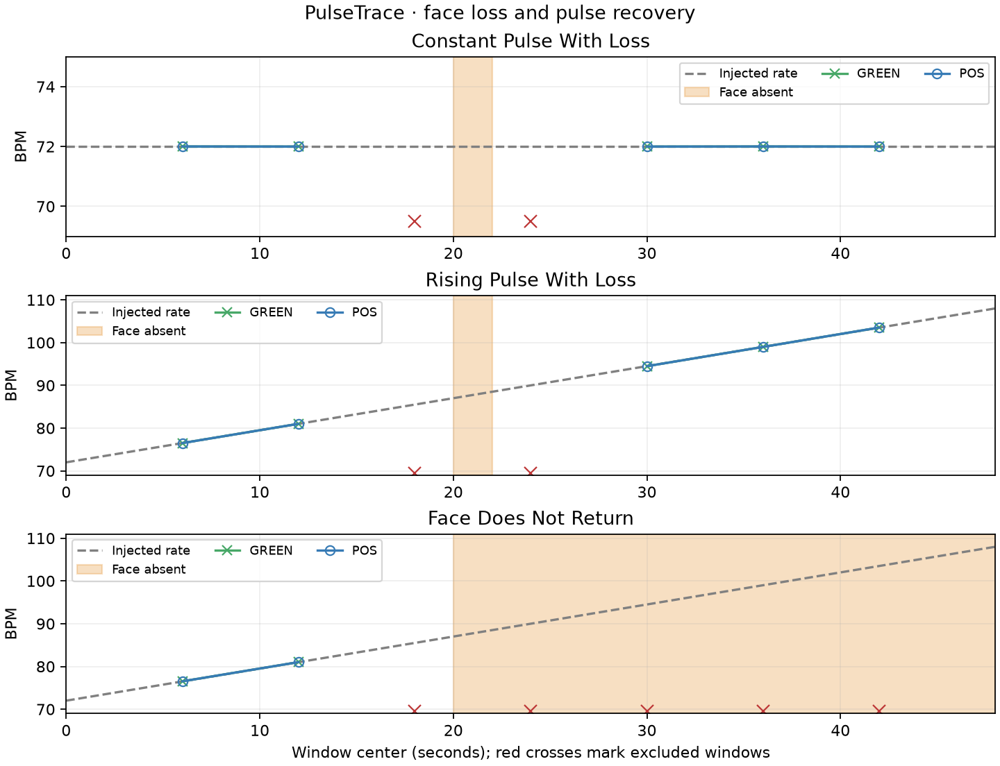

# Face loss and pulse recovery

PulseTrace includes lossless synthetic videos in which the rendered face
disappears. The fixture tracker returns no landmarks while the face is absent,
so the full pipeline receives missing RGB samples and zero sampled pixels.
The pulse phase continues with video time when the face returns.



## Protocol

Three 48-second clips use the existing 12-second windows, six-second step,
zone consensus, and default regional quality gate. Signal estimation and voting
do not receive injected BPM or visibility metadata.

| Synthetic case | Input | Injected pulse | Face absence |
|---|---|---|---|
| Constant pulse with loss | 30 FPS | 72 BPM | 20–22 seconds |
| Rising pulse with loss | 60 FPS | 72→108 BPM linear ramp | 20–22 seconds |
| Face does not return | 30 FPS | 72→108 BPM linear ramp | 20 seconds through clip end |

The [fixed protocol](../examples/tracking-loss/protocol.json) specifies these cases.
The [results](../examples/tracking-loss/benchmark.json) include source hashes,
decoded frame counts, patch coverage, every window decision, errors against the
injected window-average rate, and estimate availability after recovery.

The synthetic tracker uses known fixture visibility and geometry. This exercises
the missing-sample path independently of MediaPipe inference. Both green and POS
use the same decoded frames and exclusions. Windows with any excluded frames in
a parent region cannot use that region. Missing estimates stay missing in plots,
JSON, and CSV; no BPM value is carried forward through a disappearance.

## Results

The suite decodes **5,760 frames** and retains **12/21 window estimates** for each
method. All nine windows affected by face absence remain empty. Across accepted
windows, POS has **0.009 BPM mean absolute error** and **0.025 BPM maximum error**
against the injected window-average rate.

| Synthetic case | POS readings / windows | POS mean absolute error | First recovered estimate available |
|---|---:|---:|---|
| Constant pulse with loss | 5 / 7 | 0.0018 BPM | 36 seconds |
| Rising pulse with loss | 5 / 7 | 0.0122 BPM | 36 seconds |
| Face does not return | 2 / 7 | 0.0190 BPM | None |

Both brief-loss cases recover on the 24–36 second window, available 14 seconds
after the face reappears. In the rising case, the recovered POS value is
94.486 BPM against an injected window average of 94.5 BPM. The last estimate
before the gap was 81.008 BPM. The no-return case produces no estimate after
the disappearance and reports null recovery times.

## Read the exports

`pulse_trend.json` and `pulse_trend.csv` now distinguish sample loss from other
quality exclusions:

- `sample_loss_regions` lists parents containing zero-pixel, nonfinite, or
  nonpositive RGB samples within the window. It describes observed samples,
  rather than assuming every quality rejection is tracking loss.
- `excluded_regions` also includes exclusions caused by motion, area changes,
  and the quality buffer. A buffered exclusion can occur outside the actual loss.
- Each method has an `unavailable_reason`: `quality_exclusion` when fewer than
  two parent regions remain usable, or `insufficient_pulse_support` when the
  remaining candidates do not support an estimate. Successful estimates have
  a null reason. This is a diagnostic classification of the existing decisions.
- `available_at_s` records the window end. A point plotted at its window center
  is available only after that whole window has been collected.

Older regional reports without sample-loss details remain readable; the new field
defaults to an empty list. CSV keeps all existing columns and appends the new
sample-loss and per-method reason columns.

## Reproduce

```bash
python scripts/benchmark_tracking_loss.py --output outputs/tracking-loss
```

Run a rising pulse with a brief disappearance:

```bash
pulsetrace demo --profile face_loss --bpm 72 --end-bpm 108 --seconds 48 \
  --fps 60 --patches --consensus zone --track --output outputs/face-loss-demo
```

Use `--profile face_loss_tail` to keep the face absent until the clip ends.
Both profiles require at least 36 seconds to include post-event windows.
